<div align="center">

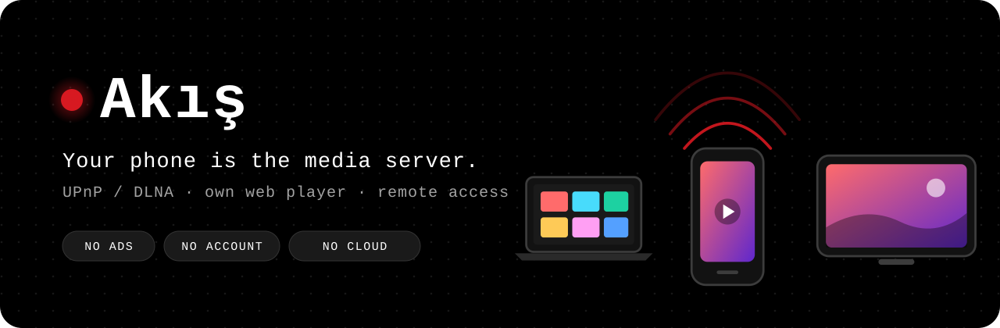

<br>

[](https://github.com/onurcakirtr/akis/releases/latest)
[](https://github.com/onurcakirtr/akis/actions/workflows/build.yml)
[](https://github.com/onurcakirtr/akis/releases)
<br>


[](LICENSE)

**[🇬🇧 English](#-english)** · **[🇹🇷 Türkçe](#-türkçe)**

</div>

---

<details open id="-english">
<summary><b>🇬🇧 English</b></summary>

<br>

**Akış** (Turkish for *flow*) turns your Android phone into a media server for your home.
Your **TV, VLC, Kodi, Windows** and any **browser** on the same Wi-Fi see your videos, music and photos instantly —
no ads, no account, no cloud. When you want, it also works **from anywhere** through a Cloudflare Tunnel.

<div align="center">
<table>
<tr>
<td align="center" width="30%">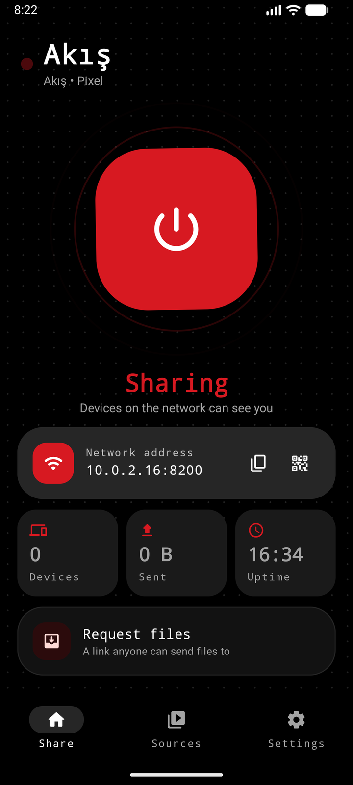<br><sub><b>The app</b> — one big button</sub></td>
<td align="center" width="70%">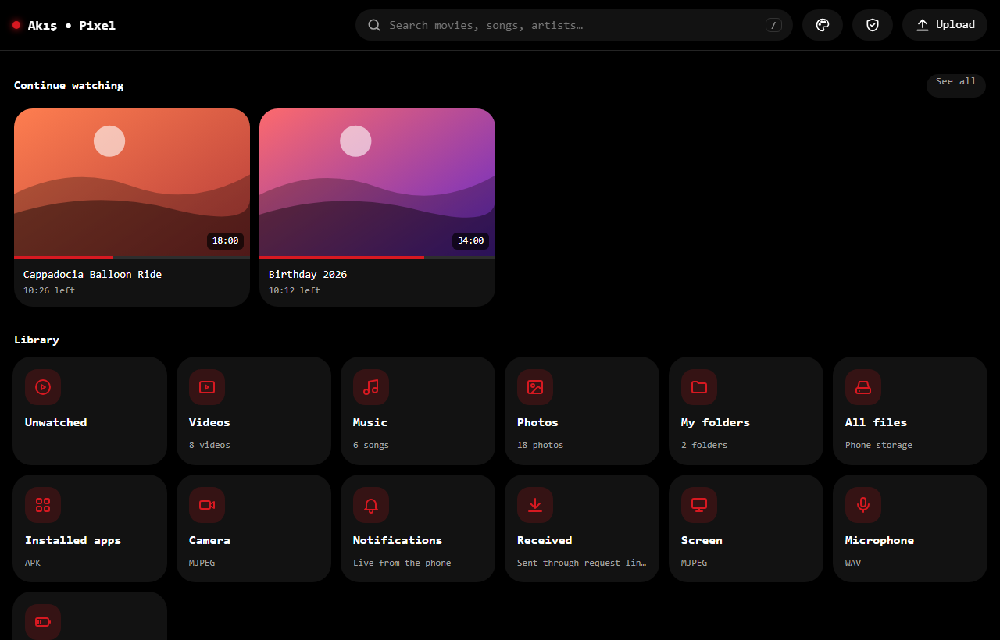<br><sub><b>The web interface</b> — on any PC, TV or phone browser</sub></td>
</tr>
</table>
</div>

## ✨ Highlights

<table>
<tr>
<td width="33%" valign="top">

### 📺 Plays everywhere
Shows up by itself in **VLC, Kodi, Google TV / smart TVs, Windows Explorer** via UPnP/DLNA.
Seeking, thumbnails, album art, subtitles and live library updates.

</td>
<td width="33%" valign="top">

### 🎬 Its own web player
Not the browser's default player: the phone **repackages videos on the fly**, so MKV, HEVC and AC3/DTS audio play in the browser.
Pick the audio track and subtitles of dual-audio files.

</td>
<td width="33%" valign="top">

### 🌍 Remote access
Built-in **Cloudflare Tunnel**: a random `trycloudflare.com` address or your own domain.
Separate password, 2-step codes, approval on the phone and per-feature permissions.

</td>
</tr>
<tr>
<td valign="top">

### 📁 Files &amp; sharing
Browse all files, preview documents, look inside ZIPs, download folders as ZIP,
timed share links, **file request links**, drag-and-drop upload.

</td>
<td valign="top">

### 📡 Live streams
Camera, screen and microphone as **live streams** — in the browser and on TVs/VLC
(**HD H.264 + AAC** in MPEG-TS). Only on while someone is watching.

</td>
<td valign="top">

### 🎨 12 themes, 2 languages
Material You, Nothing, Samsung, Cyberpunk, iOS, Terminal and more — the web interface follows.
English and Turkish; every browser can choose its own.

</td>
</tr>
</table>

> [!NOTE]
> **Every feature has its own switch** in Settings. Sensitive ones (camera, microphone, screen, notifications, installed apps, ringing the phone) are **off by default** and need a separate permission for remote access.

## 📸 Screenshots

### The app

<div align="center">
<table>
<tr>
<td align="center"><br><sub>Home</sub></td>
<td align="center">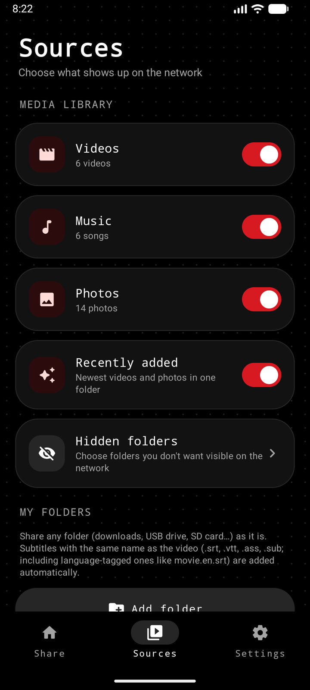<br><sub>Sources</sub></td>
<td align="center">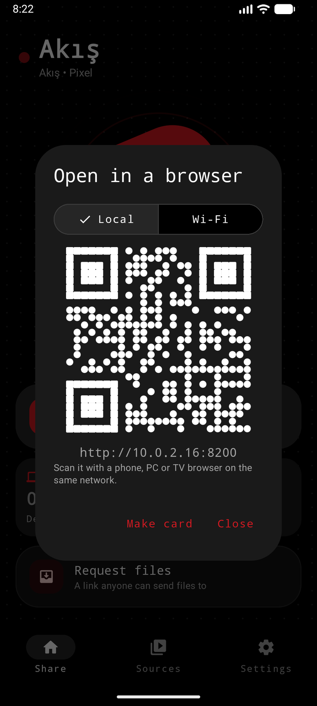<br><sub>Open with a QR code</sub></td>
<td align="center">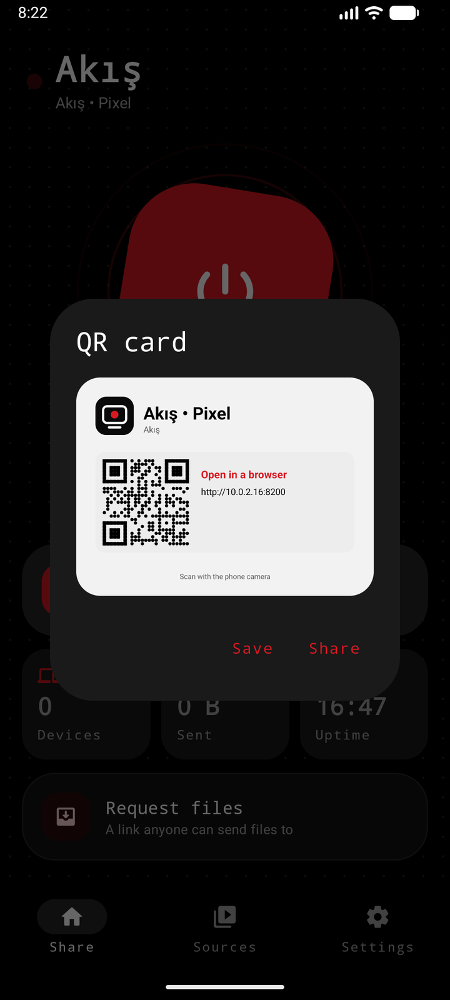<br><sub>Printable QR card</sub></td>
</tr>
<tr>
<td align="center">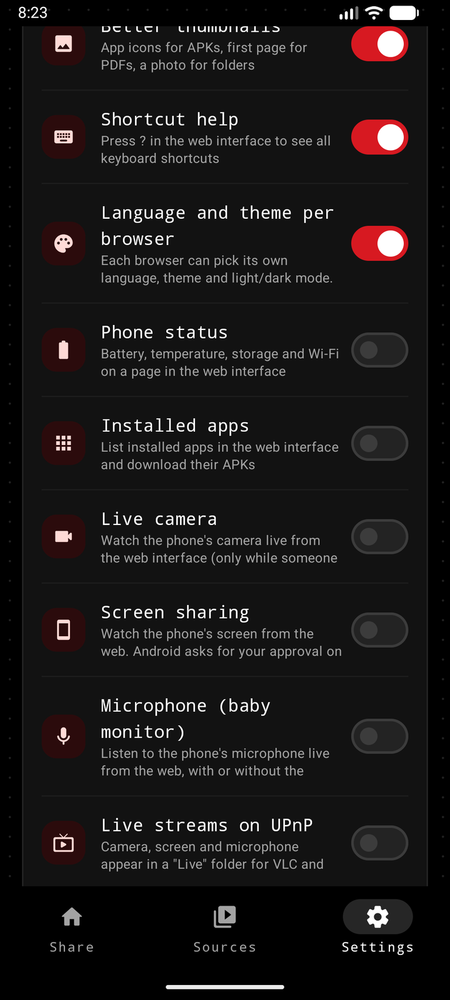<br><sub>Web features, one switch each</sub></td>
<td align="center">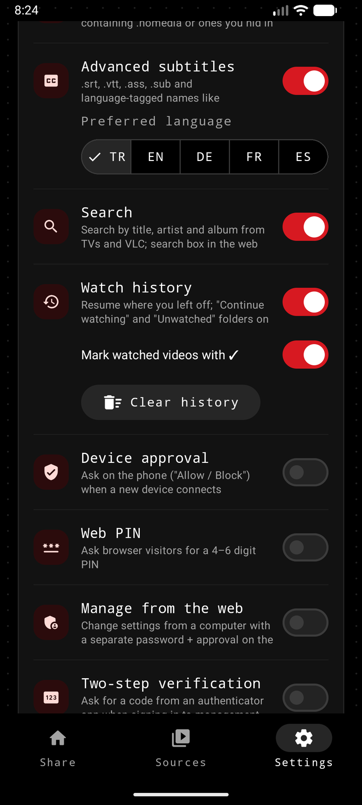<br><sub>Security</sub></td>
<td align="center">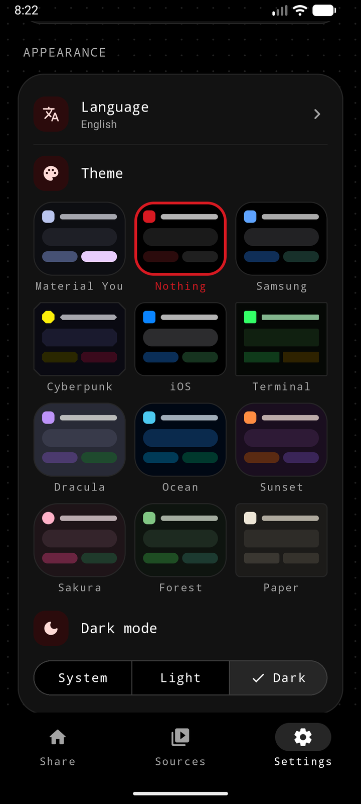<br><sub>Theme picker</sub></td>
<td align="center">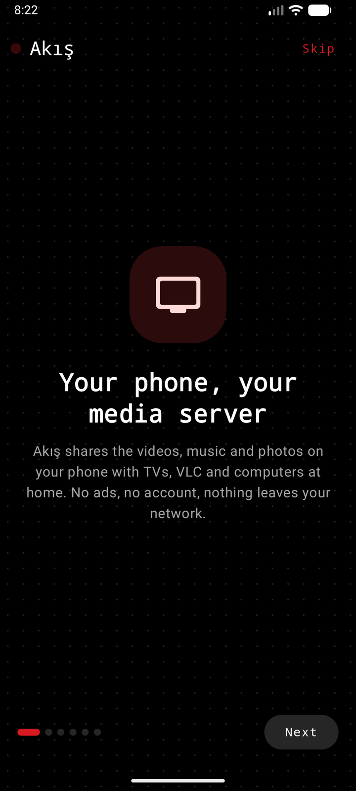<br><sub>First-run tour</sub></td>
</tr>
</table>
</div>

### The web interface

<div align="center">
<table>
<tr>
<td align="center" colspan="2">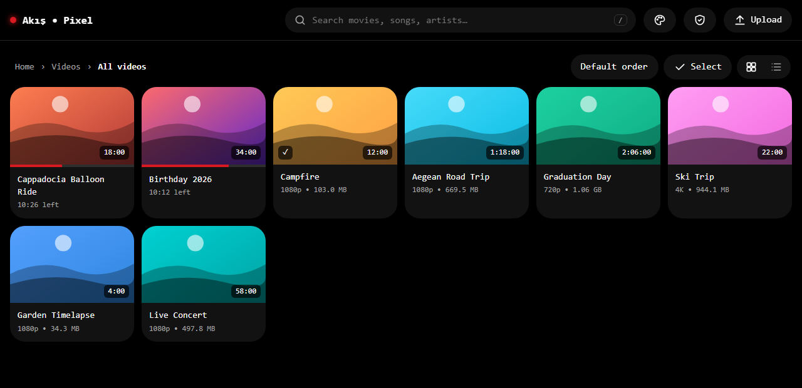<br><sub>Library with progress and watched marks</sub></td>
<td align="center" rowspan="2" width="24%">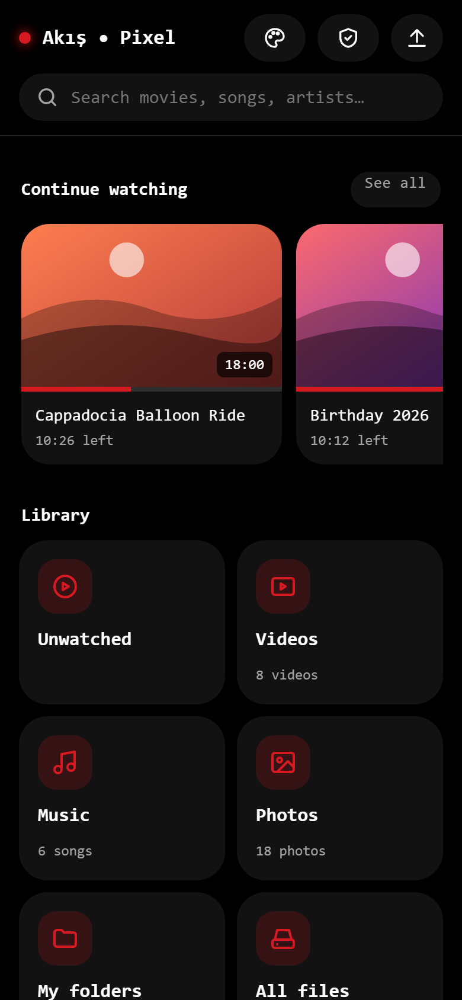<br><sub>On a phone</sub></td>
</tr>
<tr>
<td align="center"><br><sub>Photos</sub></td>
<td align="center">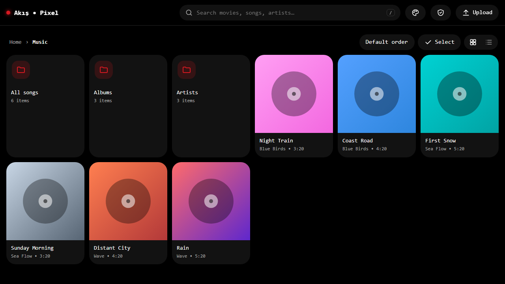<br><sub>Music</sub></td>
</tr>
<tr>
<td align="center">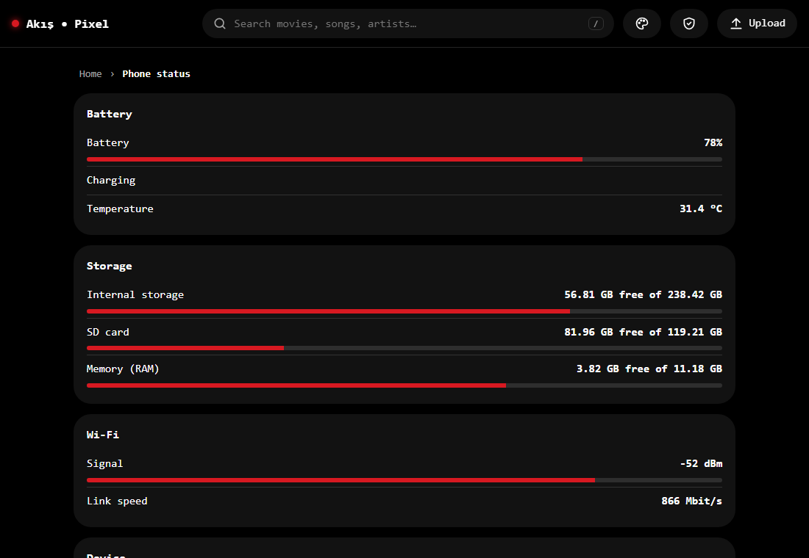<br><sub>Phone status</sub></td>
<td align="center" colspan="2">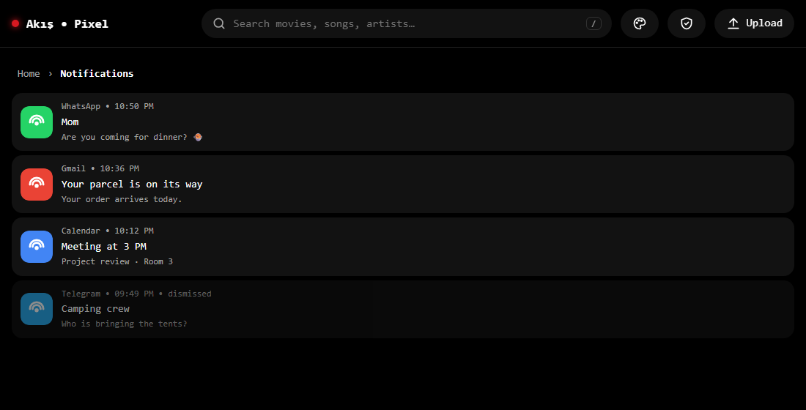<br><sub>Notification mirroring</sub></td>
</tr>
</table>
</div>

### 🎨 Themes

<div align="center">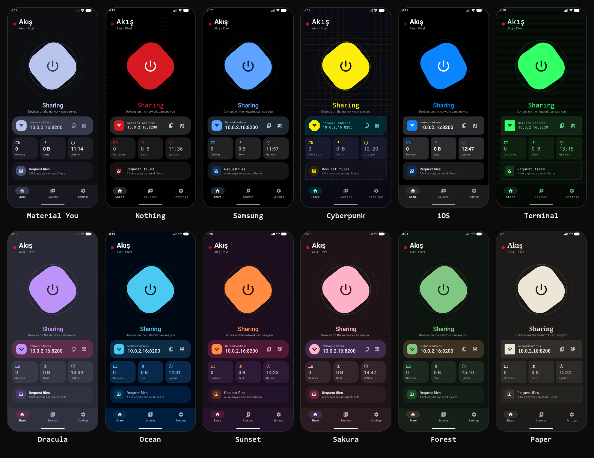</div>

## 🚀 Install

1. Download the latest APK from [**Releases**](https://github.com/onurcakirtr/akis/releases/latest):

   | File | What's inside |
   |---|---|
   | **`Akis-x.y.z.apk`** — *recommended* | Everything except the features below |
   | **`Akis-Full-x.y.z.apk`** | Also live camera, microphone, screen sharing, notification mirroring and installed apps |

2. Open it on your phone and allow installing from this source.
3. Open Akış — the short tour explains the rest.

Both editions use the same package, so Full can be installed over the standard one (and back).

> [!IMPORTANT]
> **Google Play Protect** checks every app that isn't from the Play Store. Akış is open source (GPL-3.0) and signed with the same key on every release, but Play Protect may still show a warning — more likely for **Full**, because camera, microphone, screen capture and notification access together look like monitoring apps to an automatic scan.
> If you see a warning, tap **More details → Install anyway**. The code that runs is exactly what you see in this repository; every APK is built by GitHub Actions from it.

**Requirements:** Android 10 or newer. Remote access needs a 64-bit ARM phone (almost all phones from the last years).

<details open>
<summary><b>Build it yourself</b></summary>

1. Install **Android Studio** and **JDK 25**.
2. `File → Open` the project folder and wait for Gradle sync.
3. Press ▶ Run with your phone connected, or `Build → Build APK(s)`.

```bash
./gradlew assembleStandardRelease assembleFullRelease
```

The APKs are in `app/build/outputs/apk/standard/release/` and `…/full/release/`. In Android Studio pick the edition under *Build Variants* (`standardDebug` / `fullDebug`).
</details>

## 🧭 Quick start

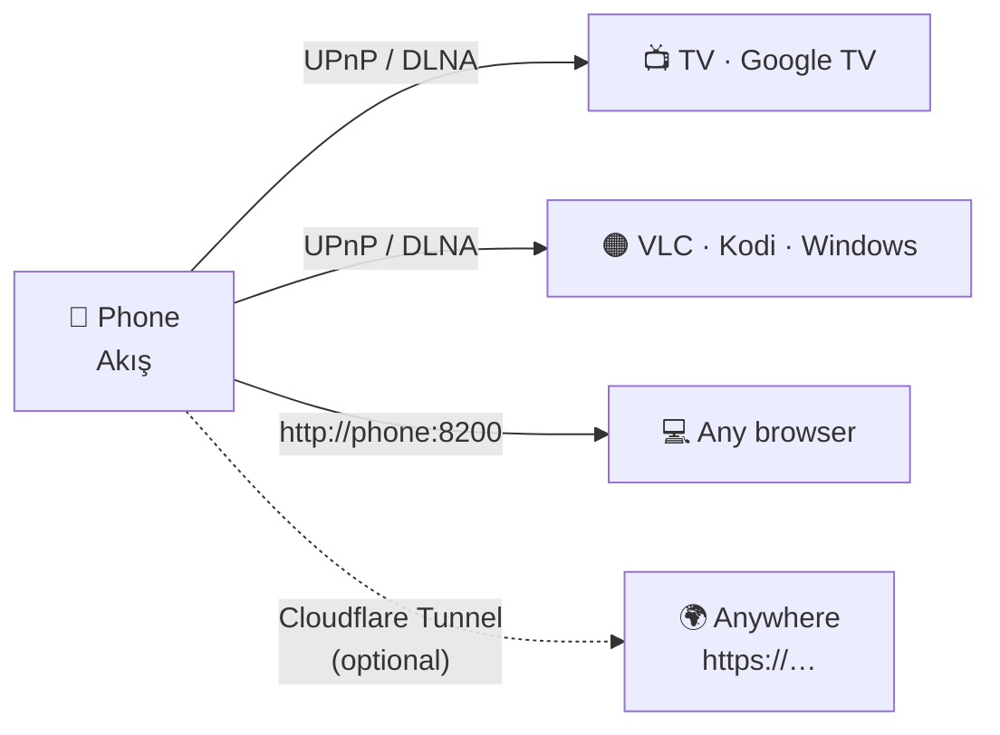

1. Connect the phone and the other device to the **same Wi-Fi** (the phone's hotspot works too).
2. Open Akış and tap the **big button**.
3. Watch:
   - **VLC:** *Local Network → Universal Plug'n'Play → Akış • (phone name)*
   - **TV:** open the TV's media / "Media Server" app and pick **Akış**
   - **Browser:** open the address shown in the app (`http://192.168.x.x:8200`) or scan the **QR code**

## 🔌 Works with

| Where | How |
|---|---|
| **VLC** (Windows, macOS, Linux, Android, iOS) | *Local Network → UPnP*; subtitles and live streams too |
| **Kodi** | *Videos → Files → Add source → Browse → UPnP devices* |
| **Google TV / Android TV / smart TVs** | Built-in media player, or VLC / Kodi from the store |
| **Windows** | Shows up under *Network* in File Explorer and in Media Player |
| **iPhone / iPad** | VLC or Infuse (UPnP), or simply Safari |
| **Any browser** | Full web interface and player — keyboard, touch and TV-remote friendly |
| **Home screen** | *Add to home screen* turns the web interface into an app (full install on the HTTPS remote address) |
| **Anywhere on the internet** | Cloudflare Tunnel — quick tunnel (no account) or your own domain/subdomain |
| **Share menu** | *Share → Akış* on any file creates a timed download link with a QR code |

## 📚 Features in detail

<details open>
<summary><b>📺 Library and UPnP / DLNA</b></summary>

- Automatic discovery (SSDP) — no IP to type
- Videos (per folder), Music (all / albums / artists / folders), Photos, Recently added
- **My folders:** share any folder (Downloads, SD card, USB OTG) as it is
- **All files:** the whole storage, like a file server
- **Continue watching** and **Unwatched** folders, ✓ on watched items, resume where you left off
- Subtitles: `.srt .vtt .ass .sub`, language-tagged names like `movie.en.srt`, encoding fixes, embedded MKV subtitles sent to TVs too
- Search from the TV/VLC and from the web
- Instant updates: new files show up on TVs (UPnP events) and in open web pages
- Hidden folders (`.nomedia` and your own choice)
- Custom server icon shown next to the name in VLC, Explorer and on TVs
- **Live folder:** camera, screen and microphone as live items; **HD** items (H.264 + AAC in MPEG-TS) play on TVs and VLC
</details>

<details open>
<summary><b>🎬 Web interface and player</b></summary>

- Own player, built from scratch: the phone **remuxes** videos to fragmented MP4 on the fly and converts AC3/DTS audio to AAC
- Audio track and subtitle selection, remembered per language; subtitle style, size, position and sync
- Touch gestures (seek, volume, brightness), keyboard shortcuts (press `?`), TV-remote arrows
- Speed, picture-in-picture, autoplay next, fit / fill
- Music bar with queue and shuffle; photo viewer with slideshow
- Properties of every item (EXIF, video / audio tracks, tags)
- Multi-select: download as ZIP, add to the music queue
- Every browser picks its **own language, theme and light/dark mode** — by default it follows the phone
</details>

<details open>
<summary><b>📁 Files and sharing</b></summary>

- Document preview (PDF, text, code, Markdown, JSON), look inside ZIPs, better thumbnails (APK icons, PDF first page, folder covers)
- Folder → ZIP download
- **Quick share:** *Share → Akış* creates a timed (or one-time) link with a QR code
- **File request link:** whoever opens it can **only send** files to your phone — limit by time, total size or one file; files land in *Downloads/Akış/Received*
- **Received** list: who sent what and when; open, share or delete
- Drag-and-drop upload from a computer
- **Wi-Fi QR:** a guest scans once to join your Wi-Fi, the Akış address is right below
- **QR card:** a printable card with the name, addresses and Wi-Fi
</details>

<details open>
<summary><b>📱 Phone tools (all off by default; camera, microphone, screen, notifications and apps need the Full edition)</b></summary>

- Phone status: battery, temperature, storage, memory, Wi-Fi
- Installed apps with APK download (split APKs as `.apks`)
- Live camera (front / back, 480p / 720p) and snapshot
- Microphone — a baby monitor, with or without the camera
- Screen sharing — Android asks for approval on the phone **every time**
- Notification mirroring — last 50, memory only, optional "title only"
- Ring the phone — only from the web admin page, full volume for 30 s even on silent
</details>

<details open>
<summary><b>🔒 Security</b></summary>

- New devices need approval on the phone (*Allow / Block*)
- Optional web PIN
- Kick, temporary ban (15 min / 1 h / 1 day) or permanent block
- Web admin: separate password (PBKDF2) + approval on the phone, single and timed session; security settings stay phone-only
- Two-step verification (TOTP, any authenticator app)
- Speed limit per connection, separately for local and remote
- Remote access: separate password, 2-step code, optional approval on the phone, 7-day sessions; TV/DLNA and admin are never reachable remotely
</details>

<details open>
<summary><b>🎨 Customisation</b></summary>

- 12 themes: Material You, Nothing, Samsung, Cyberpunk, iOS, Terminal, Dracula, Ocean, Sunset, Sakura, Forest, Paper — light / dark / system
- English and Turkish (app and web); adding a language is one file
- Home-screen widgets, quick-settings tile, rich notification with progress
- Start on launch, keep awake
</details>

## 🌍 Remote access (Cloudflare Tunnel)

> [!WARNING]
> Remote access puts your server on the internet. Set a strong password and turn on 2-step verification; only enable the remote features you need.

**Quick tunnel (no account):** *Settings → Remote access → Quick tunnel* and turn it on. A random `https://…trycloudflare.com` address appears on the home screen and in the QR window. It changes every time.

**Your own domain:**
1. In the [Cloudflare dashboard](https://one.dash.cloudflare.com/) go to *Networks → Tunnels → Create a tunnel*.
2. Add a public hostname (e.g. `akis.example.com`) pointing to `http://localhost:8200`.
3. Paste the tunnel **token** and your address into *Settings → Remote access → Own domain*.

## 🛡️ Permissions

| Permission | Why |
|---|---|
| Photos, videos, music | To share your library |
| All files access *(optional)* | "All files" and folder paths |
| Notifications | Server status, device approvals, received files |
| Camera / Microphone *(optional)* | Live camera and baby monitor — only while someone watches or listens |
| Notification access *(optional)* | Notification mirroring |
| Screen capture *(asked every time)* | Screen sharing |
| Installed apps | App list and APK download *(optional feature)* |

Nothing is sent anywhere unless you enable remote access. No analytics, no ads.

## ❓ Troubleshooting

<details open>
<summary><b>The TV / VLC doesn't see the phone</b></summary>

- Guest networks and some routers have **AP / client isolation** — turn it off or use the phone's hotspot.
- Refresh the list in VLC; if needed, stop and start Akış.
- Battery optimisation: *Settings → Apps → Akış → Battery → Unrestricted*.
</details>

<details open>
<summary><b>A video doesn't play in the browser</b></summary>

The web player can repackage most videos. If a codec isn't supported by the browser (e.g. some HEVC on desktop Chrome), use **Open in VLC** on the video page or play it on the TV.
</details>

<details open>
<summary><b>Camera / microphone don't work</b></summary>

Start the server from the app (not from the widget or tile) — Android only allows camera and microphone for services started while the app is open.
</details>

## 🧩 Project structure

```
app/src/main/java/com/akis/app/
├─ net/            HTTP/1.1 server (keep-alive, Range), SSDP, network helpers
├─ dlna/           UPnP device, ContentDirectory, DIDL-Lite, web API, remux (fMP4), MKV, subtitles
├─ service/        Foreground service, quick-settings tile
├─ ui/             Jetpack Compose + Material 3 screens, 12 themes
├─ widget/         Home-screen widgets
├─ LiveTs.kt       HD live stream (H.264 + AAC → MPEG-TS)
├─ Tunnel.kt       Cloudflare Tunnel (bundled cloudflared)
└─ …               Access control, admin, TOTP, shares, file requests, notifications
app/src/main/assets/web/   Web app (HTML, CSS, JS — no framework)
```

**Add a language:** copy `res/values/strings.xml` to `res/values-<code>/strings.xml`, translate it and add a line to `SUPPORTED` in `Lang.kt`.
**Add a theme:** add an `AppTheme` to `Themes.ALL` in `ui/theme/Theme.kt` and its name (`theme_<id>`) to the strings.

## 📦 Releases

Releases are built automatically by GitHub Actions. Push a tag and the APK appears under *Releases* a few minutes later:

```bash
git tag v1.1.0
git push origin v1.1.0
```

To sign with your own key, add `AKIS_KEYSTORE_BASE64`, `AKIS_KEYSTORE_PASSWORD`, `AKIS_KEY_ALIAS` and `AKIS_KEY_PASSWORD` as repository secrets; otherwise a debug key is used.

## 📜 License

Akış is free software under the **[GNU General Public License v3.0](LICENSE)**.
You may use, study, change and share it; if you distribute it or a modified version, you must keep the same license and publish the full source code.
Contributions are welcome — open an issue or a pull request.

Copyright © 2026 onurcakirtr

## 🙏 Credits

- [cloudflared](https://github.com/cloudflare/cloudflared) (Apache-2.0) — Android build from the [Termux](https://github.com/termux/termux-packages) package, bundled as `libcloudflared.so`
- [ZXing](https://github.com/zxing/zxing) (Apache-2.0) — QR codes
- Jetpack Compose, Material 3, AndroidX

</details>

---

<details open id="-türkçe">
<summary><b>🇹🇷 Türkçe</b></summary>

<br>

**Akış**, Android telefonunu evin medya sunucusuna çevirir.
Aynı Wi-Fi'daki **TV, VLC, Kodi, Windows** ve her **tarayıcı** videolarını, müziklerini ve fotoğraflarını anında görür —
reklam yok, hesap yok, bulut yok. İstersen Cloudflare Tunnel ile **her yerden** de çalışır.

<div align="center">
<table>
<tr>
<td align="center" width="30%">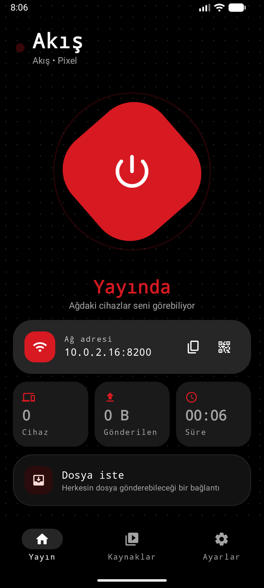<br><sub><b>Uygulama</b> — tek büyük düğme</sub></td>
<td align="center" width="70%">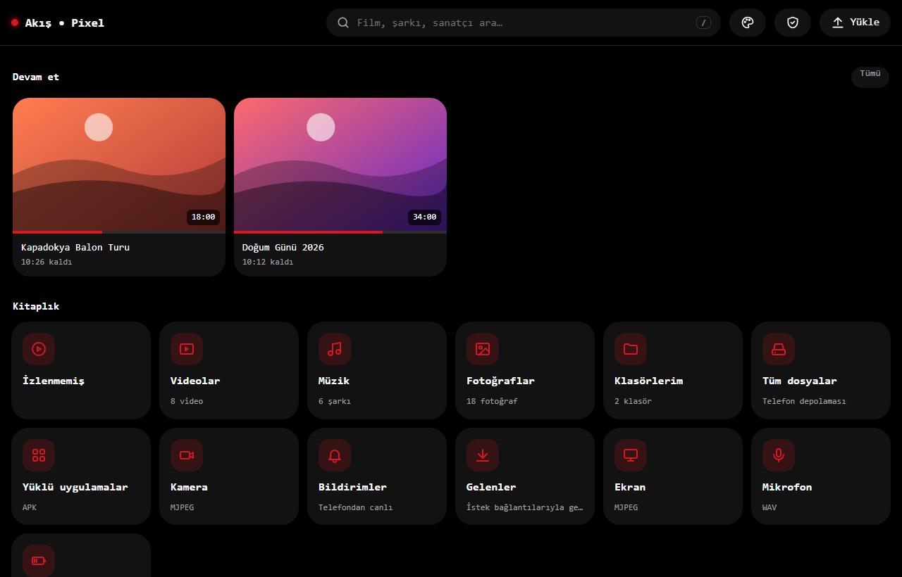<br><sub><b>Web arayüzü</b> — her bilgisayar, TV ya da telefon tarayıcısında</sub></td>
</tr>
</table>
</div>

## ✨ Öne çıkanlar

<table>
<tr>
<td width="33%" valign="top">

### 📺 Her yerde oynar
UPnP/DLNA ile **VLC, Kodi, Google TV / akıllı TV'ler, Windows Gezgini**'nde kendiliğinden görünür.
İleri-geri sarma, küçük resimler, albüm kapakları, altyazılar ve anında yenilenen kitaplık.

</td>
<td width="33%" valign="top">

### 🎬 Kendi web oynatıcısı
Tarayıcının varsayılan oynatıcısı değil: telefon videoyu **anında yeniden paketler**; MKV, HEVC ve AC3/DTS sesler tarayıcıda oynar.
Çift dublajlı dosyalarda ses ve altyazı seçimi.

</td>
<td width="33%" valign="top">

### 🌍 Uzaktan erişim
Dahili **Cloudflare Tunnel**: rastgele `trycloudflare.com` adresi ya da kendi alan adın.
Ayrı şifre, iki adımlı kod, telefonda onay ve özellik başına izin.

</td>
</tr>
<tr>
<td valign="top">

### 📁 Dosyalar ve paylaşım
Tüm dosyalar, belge önizleme, ZIP içine bakma, klasörü ZIP indirme,
süreli paylaşım bağlantıları, **dosya isteme bağlantısı**, sürükle-bırak yükleme.

</td>
<td valign="top">

### 📡 Canlı yayın
Kamera, ekran ve mikrofon **canlı yayın** olarak — tarayıcıda ve TV/VLC'de
(**HD H.264 + AAC**, MPEG-TS). Yalnızca biri izlerken açık.

</td>
<td valign="top">

### 🎨 12 tema, 2 dil
Material You, Nothing, Samsung, Cyberpunk, iOS, Terminal ve dahası — web arayüzü de uyar.
Türkçe ve İngilizce; her tarayıcı kendi dilini seçebilir.

</td>
</tr>
</table>

> [!NOTE]
> Ayarlar'da **her özelliğin kendi düğmesi** var. Hassas olanlar (kamera, mikrofon, ekran, bildirimler, yüklü uygulamalar, telefonu çaldırma) **varsayılan olarak kapalı** ve uzaktan erişim için ayrıca izin ister.

## 📸 Ekran görüntüleri

### Uygulama

<div align="center">
<table>
<tr>
<td align="center"><br><sub>Ana ekran</sub></td>
<td align="center">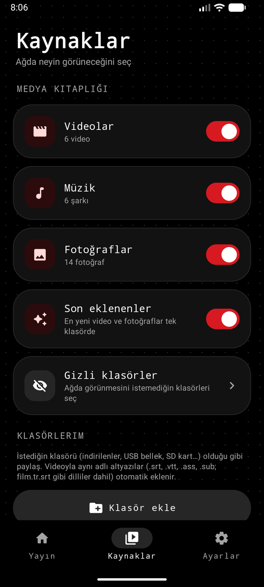<br><sub>Kaynaklar</sub></td>
<td align="center">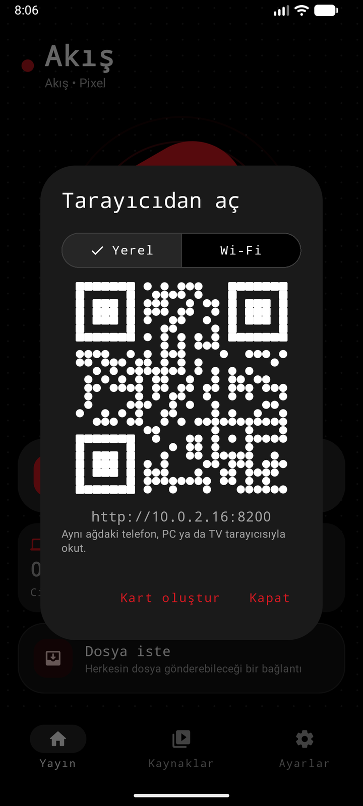<br><sub>QR ile aç</sub></td>
<td align="center">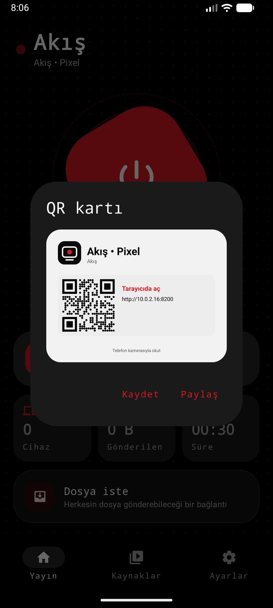<br><sub>Yazdırılabilir QR kartı</sub></td>
</tr>
<tr>
<td align="center">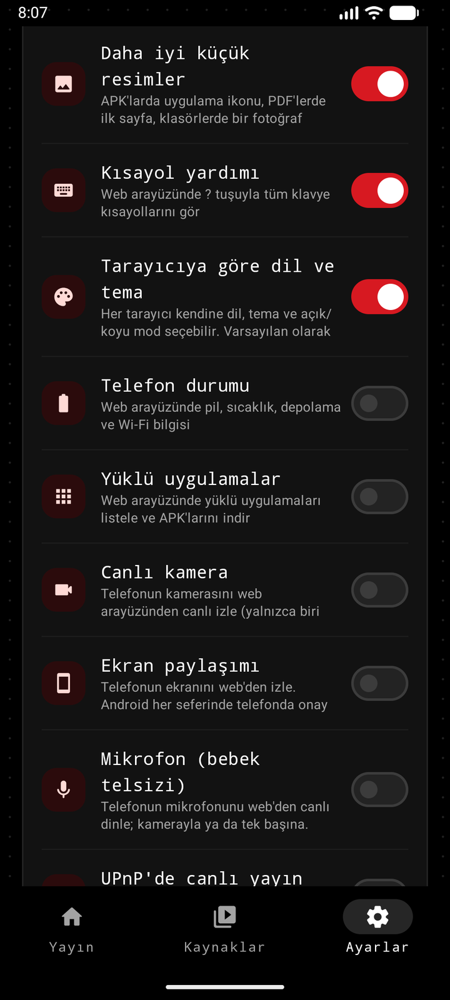<br><sub>Web özellikleri, her biri ayrı düğme</sub></td>
<td align="center">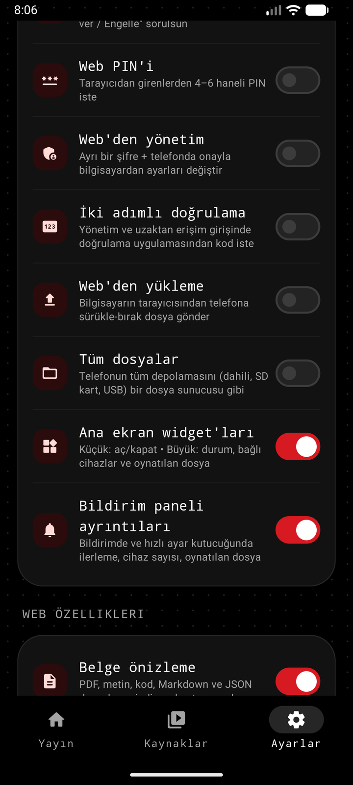<br><sub>Güvenlik</sub></td>
<td align="center">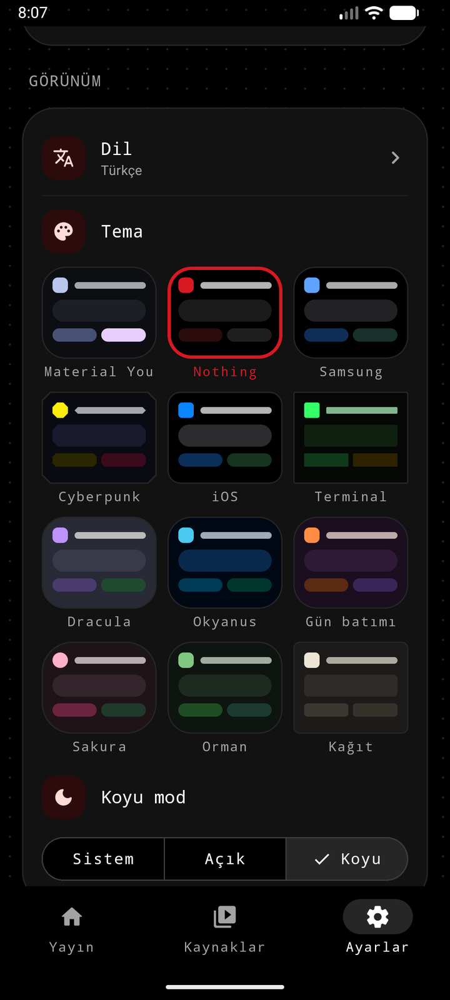<br><sub>Tema seçimi</sub></td>
<td align="center">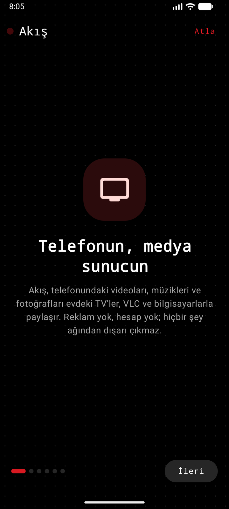<br><sub>İlk açılış tanıtımı</sub></td>
</tr>
</table>
</div>

### Web arayüzü

<div align="center">
<table>
<tr>
<td align="center" colspan="2">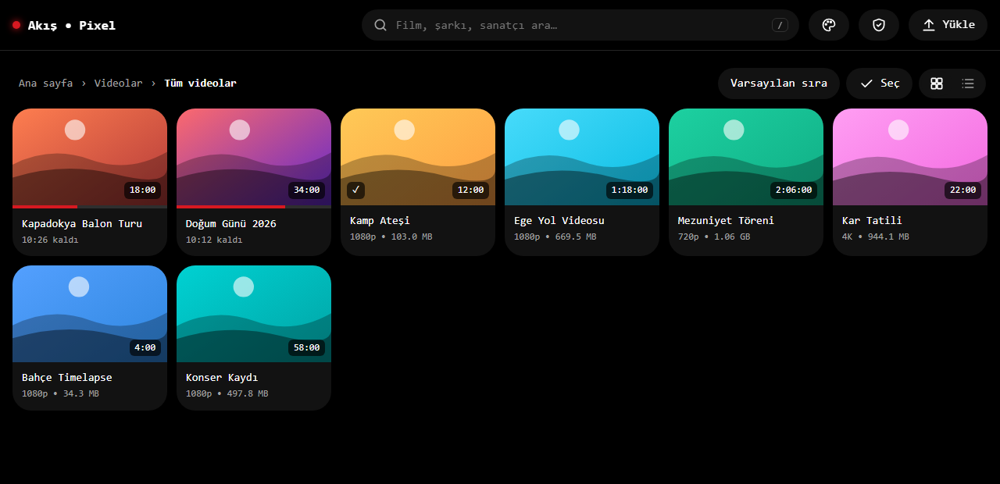<br><sub>İlerleme ve izlendi işaretli kitaplık</sub></td>
<td align="center" rowspan="2" width="24%">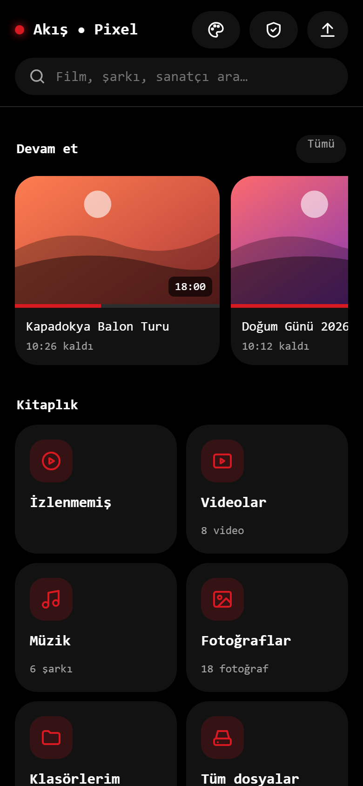<br><sub>Telefonda</sub></td>
</tr>
<tr>
<td align="center">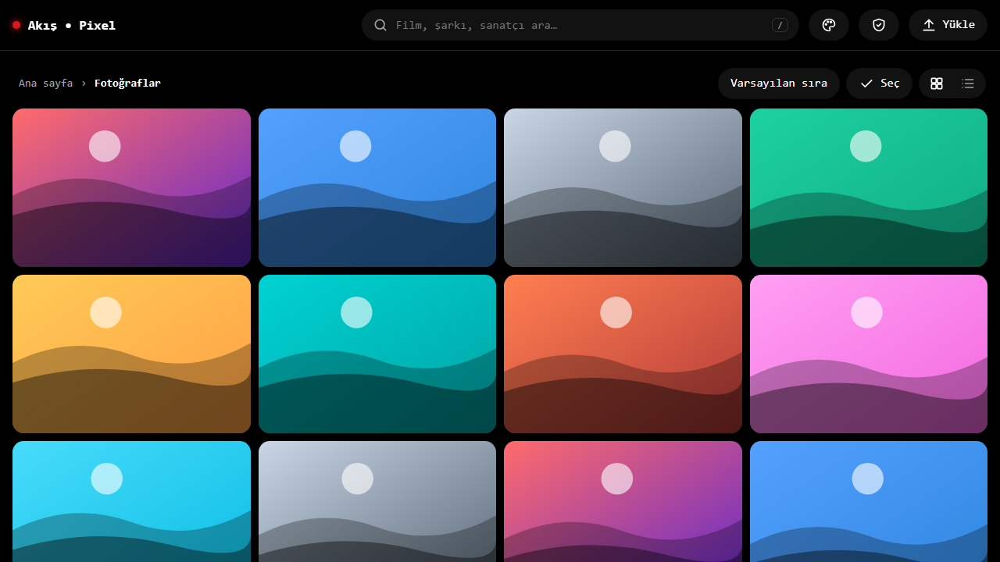<br><sub>Fotoğraflar</sub></td>
<td align="center">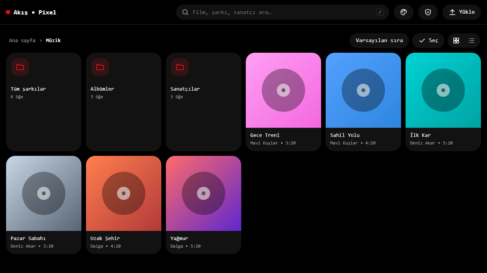<br><sub>Müzik</sub></td>
</tr>
<tr>
<td align="center">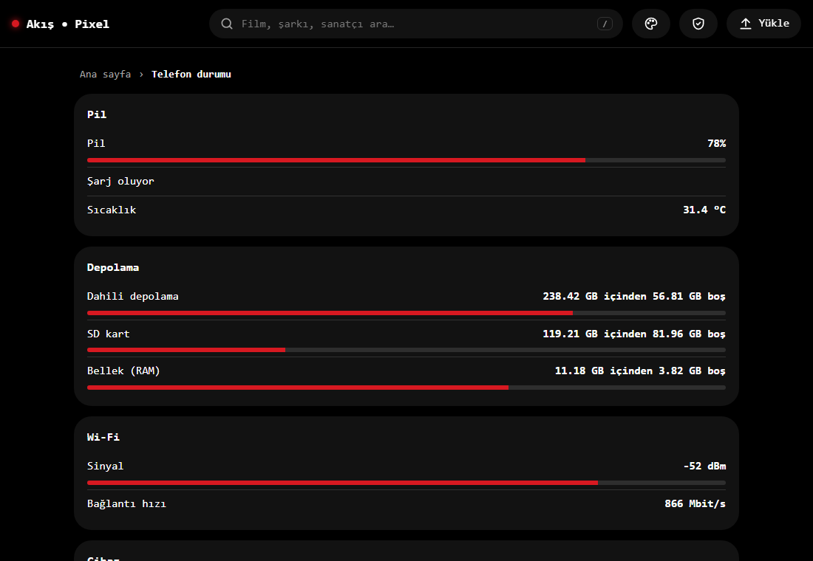<br><sub>Telefon durumu</sub></td>
<td align="center" colspan="2">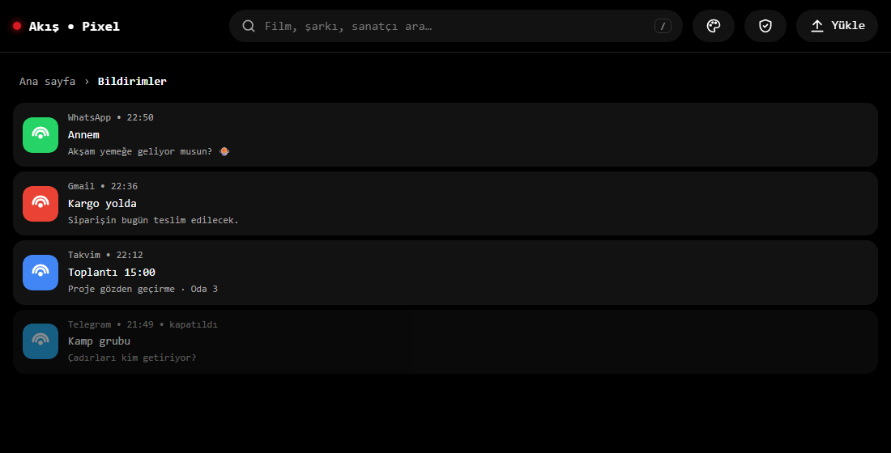<br><sub>Bildirim yansıtma</sub></td>
</tr>
</table>
</div>

### 🎨 Temalar

<div align="center">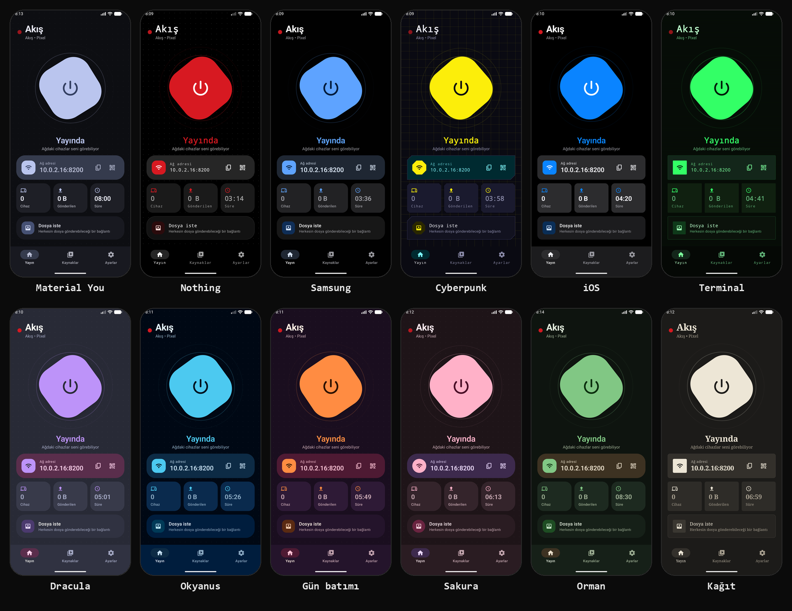</div>

## 🚀 Kurulum

1. [**Releases**](https://github.com/onurcakirtr/akis/releases/latest) sayfasından en yeni APK'yı indir:

   | Dosya | İçinde ne var |
   |---|---|
   | **`Akis-x.y.z.apk`** — *önerilen* | Aşağıdakiler hariç her şey |
   | **`Akis-Full-x.y.z.apk`** | Ek olarak canlı kamera, mikrofon, ekran paylaşımı, bildirim yansıtma ve yüklü uygulamalar |

2. Telefonda aç, bu kaynaktan yüklemeye izin ver.
3. Akış'ı aç — kısa tanıtım gerisini anlatır.

İki sürümün paket adı aynı; Full, standardın üzerine kurulabilir (tersi de).

> [!IMPORTANT]
> **Google Play Protect**, Play Store dışından gelen her uygulamayı kontrol eder. Akış açık kaynaktır (GPL-3.0) ve her sürüm aynı anahtarla imzalanır; yine de Play Protect uyarı gösterebilir — özellikle **Full** için, çünkü kamera, mikrofon, ekran kaydı ve bildirim erişimi bir arada otomatik taramaya izleme uygulaması gibi görünür.
> Uyarı çıkarsa **Ayrıntılar → Yine de yükle**'ye dokun. Çalışan kod tam olarak bu depoda gördüğün koddur; her APK GitHub Actions tarafından buradan derlenir.

**Gereksinim:** Android 10 ya da üstü. Uzaktan erişim 64 bit ARM telefon ister (son yılların neredeyse tüm telefonları).

<details open>
<summary><b>Kendin derle</b></summary>

1. **Android Studio** ve **JDK 25** kur.
2. Proje klasörünü `File → Open` ile aç, Gradle senkronizasyonunu bekle.
3. Telefon bağlıyken ▶ Run'a bas ya da `Build → Build APK(s)`.

```bash
./gradlew assembleStandardRelease assembleFullRelease
```

APK'lar `app/build/outputs/apk/standard/release/` ve `…/full/release/` klasörlerinde olur. Android Studio'da sürümü *Build Variants* penceresinden seç (`standardDebug` / `fullDebug`).
</details>

## 🧭 Hızlı başlangıç

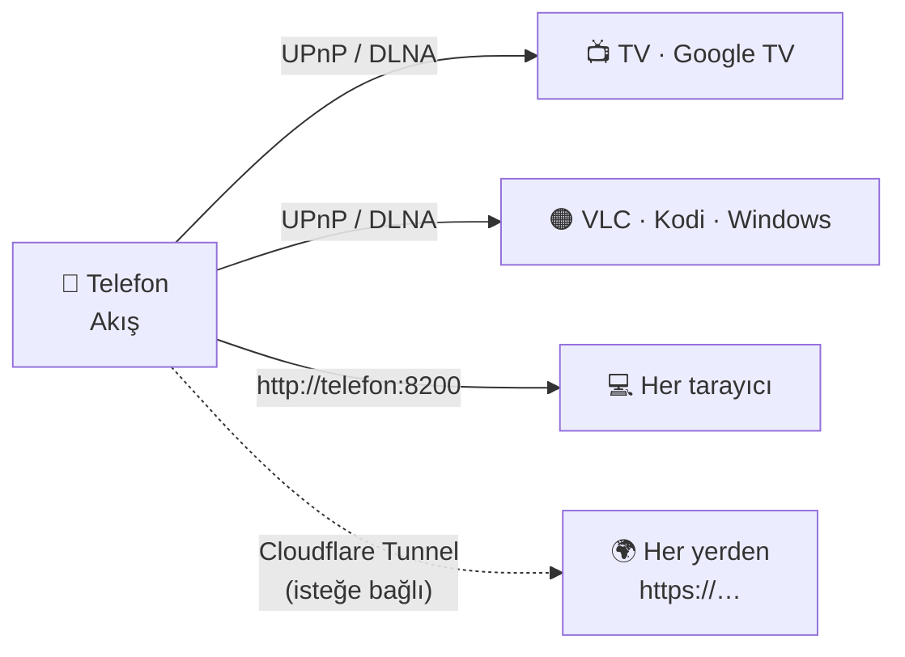

1. Telefonu ve diğer cihazı **aynı Wi-Fi**'a bağla (telefonun hotspot'u da olur).
2. Akış'ı aç ve **büyük düğmeye** bas.
3. İzle:
   - **VLC:** *Yerel Ağ → Universal Plug'n'Play → Akış • (telefon adı)*
   - **TV:** TV'nin medya / "Medya Sunucusu" uygulamasını açıp **Akış**'ı seç
   - **Tarayıcı:** uygulamada görünen adresi (`http://192.168.x.x:8200`) aç ya da **QR kodu** okut

## 🔌 Nerelerde çalışır

| Nerede | Nasıl |
|---|---|
| **VLC** (Windows, macOS, Linux, Android, iOS) | *Yerel Ağ → UPnP*; altyazılar ve canlı yayınlar dahil |
| **Kodi** | *Videolar → Dosyalar → Kaynak ekle → Gözat → UPnP cihazları* |
| **Google TV / Android TV / akıllı TV'ler** | TV'nin kendi oynatıcısı ya da mağazadan VLC / Kodi |
| **Windows** | Dosya Gezgini'nde *Ağ* altında ve Medya Oynatıcı'da görünür |
| **iPhone / iPad** | VLC ya da Infuse (UPnP) veya doğrudan Safari |
| **Her tarayıcı** | Tam web arayüzü ve oynatıcı — klavye, dokunmatik ve TV kumandası uyumlu |
| **Ana ekran** | *Ana ekrana ekle* ile web arayüzü uygulama gibi olur (HTTPS uzak adreste tam kurulum) |
| **İnternette her yerden** | Cloudflare Tunnel — hızlı tünel (hesapsız) ya da kendi alan adın / alt alan adın |
| **Paylaş menüsü** | Herhangi bir dosyada *Paylaş → Akış* süreli indirme bağlantısı ve QR kod oluşturur |

## 📚 Özellikler ayrıntılı

<details open>
<summary><b>📺 Kitaplık ve UPnP / DLNA</b></summary>

- Otomatik keşif (SSDP) — IP yazmaya gerek yok
- Videolar (klasör klasör), Müzik (tümü / albümler / sanatçılar / klasörler), Fotoğraflar, Son eklenenler
- **Klasörlerim:** istediğin klasörü (İndirilenler, SD kart, USB OTG) olduğu gibi paylaş
- **Tüm dosyalar:** bütün depolama, dosya sunucusu gibi
- **Devam et** ve **İzlenmemiş** klasörleri, izlenenlere ✓, kaldığın yerden devam
- Altyazılar: `.srt .vtt .ass .sub`, `film.tr.srt` gibi dilli adlar, Türkçe karakter düzeltme, MKV içindeki altyazılar TV'lere de gider
- TV/VLC'den ve web'den arama
- Anında yenileme: yeni dosyalar TV'lere (UPnP olayları) ve açık web sayfalarına kendiliğinden yansır
- Gizli klasörler (`.nomedia` ve senin seçtiklerin)
- VLC, Gezgin ve TV'lerde adın yanında görünen özel sunucu simgesi
- **Canlı klasörü:** kamera, ekran ve mikrofon canlı öğe olarak; **HD** öğeleri (H.264 + AAC, MPEG-TS) TV'lerde ve VLC'de oynar
</details>

<details open>
<summary><b>🎬 Web arayüzü ve oynatıcı</b></summary>

- Sıfırdan yazılmış kendi oynatıcısı: telefon videoyu anında parçalı MP4'e çevirir, AC3/DTS sesi AAC'ye dönüştürür
- Ses ve altyazı seçimi, dile göre hatırlanır; altyazı görünümü, boyutu, konumu ve senkronu
- Dokunmatik hareketler (sarma, ses, parlaklık), klavye kısayolları (`?` tuşu), TV kumandası yön tuşları
- Hız, resim içinde resim, sıradakini oynat, sığdır / doldur
- Sıralı ve karışık müzik çubuğu; slayt gösterili fotoğraf görüntüleyici
- Her öğenin özellikleri (EXIF, video / ses parçaları, etiketler)
- Çoklu seçim: ZIP olarak indir, müzik sırasına ekle
- Her tarayıcı **kendi dilini, temasını ve açık/koyu modunu** seçer — varsayılan olarak telefonu takip eder
</details>

<details open>
<summary><b>📁 Dosyalar ve paylaşım</b></summary>

- Belge önizleme (PDF, metin, kod, Markdown, JSON), ZIP içine bakma, daha iyi küçük resimler (APK ikonu, PDF ilk sayfa, klasör kapağı)
- Klasörü ZIP olarak indirme
- **Hızlı paylaşım:** *Paylaş → Akış* süreli (ya da tek seferlik) bağlantı ve QR kod oluşturur
- **Dosya isteme bağlantısı:** açan kişi telefonuna **yalnızca dosya gönderebilir** — süre, toplam boyut ya da tek dosya sınırı; dosyalar *İndirilenler/Akış/Gelenler*'e düşer
- **Gelenler** listesi: kim ne zaman ne gönderdi; aç, paylaş ya da sil
- Bilgisayardan sürükle-bırak yükleme
- **Wi-Fi QR'ı:** misafir bir kez okutup Wi-Fi'ına bağlanır, Akış adresi hemen altında
- **QR kartı:** ad, adresler ve Wi-Fi'ı içeren yazdırılabilir kart
</details>

<details open>
<summary><b>📱 Telefon araçları (hepsi varsayılan kapalı; kamera, mikrofon, ekran, bildirimler ve uygulamalar Full sürümde)</b></summary>

- Telefon durumu: pil, sıcaklık, depolama, bellek, Wi-Fi
- Yüklü uygulamalar ve APK indirme (parçalı APK'lar `.apks` olarak)
- Canlı kamera (ön / arka, 480p / 720p) ve anlık fotoğraf
- Mikrofon — bebek telsizi, kamerayla ya da tek başına
- Ekran paylaşımı — Android **her seferinde** telefonda onay ister
- Bildirim yansıtma — son 50, yalnızca bellekte, isteğe bağlı "yalnızca başlık"
- Telefonu çaldır — yalnızca web yönetim sayfasından, sessizde bile 30 sn tam ses
</details>

<details open>
<summary><b>🔒 Güvenlik</b></summary>

- Yeni cihazlar telefonda onay ister (*İzin ver / Engelle*)
- İsteğe bağlı web PIN'i
- Atma, süreli yasak (15 dk / 1 saat / 1 gün) ya da kalıcı engel
- Web'den yönetim: ayrı şifre (PBKDF2) + telefonda onay, tek ve süreli oturum; güvenlik ayarları yalnızca telefondan
- İki adımlı doğrulama (TOTP, herhangi bir doğrulama uygulaması)
- Bağlantı başına hız sınırı, yerel ve uzak için ayrı
- Uzaktan erişim: ayrı şifre, iki adımlı kod, isteğe bağlı telefonda onay, 7 günlük oturum; TV/DLNA ve yönetim uzaktan asla açılmaz
</details>

<details open>
<summary><b>🎨 Kişiselleştirme</b></summary>

- 12 tema: Material You, Nothing, Samsung, Cyberpunk, iOS, Terminal, Dracula, Okyanus, Gün batımı, Sakura, Orman, Kağıt — açık / koyu / sistem
- Türkçe ve İngilizce (uygulama ve web); yeni dil tek dosya
- Ana ekran widget'ları, hızlı ayar kutucuğu, ilerlemeli zengin bildirim
- Açılışta başlat, ekran kapalıyken çalış
</details>

## 🌍 Uzaktan erişim (Cloudflare Tunnel)

> [!WARNING]
> Uzaktan erişim sunucunu internete açar. Güçlü bir şifre koy, iki adımlı doğrulamayı aç; yalnızca gerçekten gereken uzak özellikleri aç.

**Hızlı tünel (hesapsız):** *Ayarlar → Uzaktan erişim → Hızlı tünel* ve aç. Ana ekranda ve QR penceresinde rastgele bir `https://…trycloudflare.com` adresi görünür; her açılışta değişir.

**Kendi alan adın:**
1. [Cloudflare panelinde](https://one.dash.cloudflare.com/) *Networks → Tunnels → Create a tunnel*.
2. `http://localhost:8200` adresine giden bir genel ad ekle (ör. `akis.ornek.com`).
3. Tünelin **token**'ını ve adresini *Ayarlar → Uzaktan erişim → Kendi alan adı*'na yapıştır.

## 🛡️ İzinler

| İzin | Neden |
|---|---|
| Fotoğraf, video, müzik | Kitaplığını paylaşmak için |
| Tüm dosyalara erişim *(isteğe bağlı)* | "Tüm dosyalar" ve klasör yolları |
| Bildirimler | Sunucu durumu, cihaz onayları, gelen dosyalar |
| Kamera / Mikrofon *(isteğe bağlı)* | Canlı kamera ve bebek telsizi — yalnızca biri izlerken / dinlerken |
| Bildirim erişimi *(isteğe bağlı)* | Bildirim yansıtma |
| Ekran kaydı *(her seferinde sorulur)* | Ekran paylaşımı |
| Yüklü uygulamalar | Uygulama listesi ve APK indirme *(isteğe bağlı özellik)* |

Uzaktan erişimi açmadıkça hiçbir şey hiçbir yere gönderilmez. Analiz yok, reklam yok.

## ❓ Sorun giderme

<details open>
<summary><b>TV / VLC telefonu görmüyor</b></summary>

- Misafir ağlarında ve bazı modemlerde **AP / istemci izolasyonu** açık olur — kapat ya da telefonun hotspot'unu kullan.
- VLC'de listeyi yenile; gerekirse Akış'ı kapatıp aç.
- Pil optimizasyonu: *Ayarlar → Uygulamalar → Akış → Pil → Kısıtlanmamış*.
</details>

<details open>
<summary><b>Bir video tarayıcıda oynamıyor</b></summary>

Web oynatıcısı çoğu videoyu yeniden paketleyebilir. Codec tarayıcıda desteklenmiyorsa (ör. masaüstü Chrome'da bazı HEVC'ler) video sayfasındaki **VLC'de aç**'ı kullan ya da TV'de oynat.
</details>

<details open>
<summary><b>Kamera / mikrofon çalışmıyor</b></summary>

Sunucuyu uygulamanın içinden başlat (widget ya da kutucuktan değil) — Android kamera ve mikrofonu yalnızca uygulama açıkken başlatılan servislere verir.
</details>

## 🧩 Kod yapısı

```
app/src/main/java/com/akis/app/
├─ net/            HTTP/1.1 sunucu (keep-alive, Range), SSDP, ağ yardımcıları
├─ dlna/           UPnP cihazı, ContentDirectory, DIDL-Lite, web API, remux (fMP4), MKV, altyazılar
├─ service/        Ön plan servisi, hızlı ayar kutucuğu
├─ ui/             Jetpack Compose + Material 3 ekranları, 12 tema
├─ widget/         Ana ekran widget'ları
├─ LiveTs.kt       HD canlı yayın (H.264 + AAC → MPEG-TS)
├─ Tunnel.kt       Cloudflare Tunnel (gömülü cloudflared)
└─ …               Erişim denetimi, yönetim, TOTP, paylaşımlar, dosya istekleri, bildirimler
app/src/main/assets/web/   Web uygulaması (HTML, CSS, JS — çatısız)
```

**Yeni dil:** `res/values/strings.xml` dosyasını `res/values-<kod>/strings.xml` olarak kopyalayıp çevir, `Lang.kt` içindeki `SUPPORTED` listesine bir satır ekle.
**Yeni tema:** `ui/theme/Theme.kt` içindeki `Themes.ALL` listesine bir `AppTheme`, metinlere de adını (`theme_<id>`) ekle.

## 📦 Sürümler

Sürümleri GitHub Actions kendiliğinden derler. Bir etiket gönder, birkaç dakika sonra APK *Releases* altında olur:

```bash
git tag v1.1.0
git push origin v1.1.0
```

Kendi anahtarınla imzalamak için depo sırlarına `AKIS_KEYSTORE_BASE64`, `AKIS_KEYSTORE_PASSWORD`, `AKIS_KEY_ALIAS` ve `AKIS_KEY_PASSWORD` ekle; yoksa debug anahtarı kullanılır.

## 📜 Lisans

Akış, **[GNU Genel Kamu Lisansı v3.0](LICENSE)** ile dağıtılan özgür yazılımdır.
Kullanabilir, inceleyebilir, değiştirebilir ve paylaşabilirsin; kendisini ya da değiştirilmiş bir sürümünü dağıtan herkes aynı lisansı korumak ve kaynak kodun tamamını yayımlamak zorundadır.
Katkılara açık — bir issue ya da pull request aç.

Telif hakkı © 2026 onurcakirtr

## 🙏 Teşekkürler

- [cloudflared](https://github.com/cloudflare/cloudflared) (Apache-2.0) — [Termux](https://github.com/termux/termux-packages) paketinden Android derlemesi, `libcloudflared.so` olarak gömülü
- [ZXing](https://github.com/zxing/zxing) (Apache-2.0) — QR kodlar
- Jetpack Compose, Material 3, AndroidX

</details>

<div align="center">
<br>
<sub><a href="https://github.com/onurcakirtr/akis/releases/latest">Download</a> · <a href="https://github.com/onurcakirtr/akis/issues">Issues</a> · <a href="https://github.com/onurcakirtr/akis/pulls">Pull requests</a></sub>
</div>
